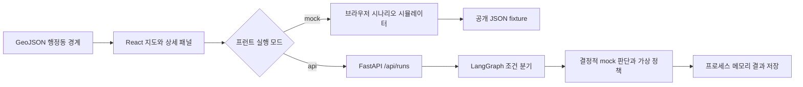

# 동행 관측소 기술 구조

이 서비스는 **실제 행정동 경계에 합성 관측 지표와 가상 정책을 표시하는 공개 시연**이다. 위험 점수는 0~100의 시연용 지수이며 개인의 고립 확률이나 검증된 지역 위험 예측이 아니다. 학습 모델, 실제 정책 자격 판정, 개인정보 처리는 현재 범위에 없다. 데이터와 API의 기준은 [CONTRACT.md](CONTRACT.md)다.

## 실행 경로와 현재 범위

| 구성 | 현재 시연 | 후속 작업 |
| --- | --- | --- |
| 프런트 `VITE_APP_MODE=mock` | 서버 없이 브라우저에서 규칙 실행. GitHub Pages 기본 배포 | 동일 화면을 API 응답에 연결 |
| 프런트 `VITE_APP_MODE=api` + 서버 `APP_MODE=mock` | HTTP 요청 후 서버에서 실제 LangGraph 실행. 판단 데이터는 합성 | 오류 시 사용자에게 실패 표시; mock 자동 전환 금지 |
| 서버 `APP_MODE=live` | 미구현. 명시적으로 실패해야 함 | 검증된 모델·데이터·정책 조회를 구현한 뒤 활성화 |
| 실행 저장 | 서버 프로세스 메모리. 기본 최대 200개·1시간 보관, 재시작 시 소실 | PostgreSQL에 결과 저장, 필요 시 LangGraph checkpointer 도입 |
| 실행 전달 | 요청 한 번으로 전체 결과 반환 | 장시간 작업이 필요해지면 큐·상태 조회·SSE 검토 |

화면의 단계 표시는 실행 결과를 이해시키기 위한 것이다. 브라우저에서 단계가 순서대로 나타난다고 서버가 스트리밍하거나 LLM이 자율적으로 추론하는 것은 아니다. `api`는 통신 방식이고 `live`는 판단 구현 상태이므로 두 용어를 바꿔 쓰지 않는다.

## 기술 선택의 이유

다음 선택은 이 프로젝트의 규모와 시연 목적에 대한 설계 판단이다. 각 기술이 무조건 필수이거나 대안보다 우수하다는 뜻은 아니다.

| 기술 | 여기서 맡는 역할과 선택 이유 | 대안과 판단 | 현재 / 추후 |
| --- | --- | --- | --- |
| React | 선택한 동, 필터, 실행 결과를 상태로 관리하고 지도·목록·상세를 함께 갱신 | Vue/Svelte도 가능. 단일 HTML은 초기 시연이 쉽지만 상호작용 증가 시 상태 동기화를 직접 관리해야 함 | 현재 UI |
| TypeScript | `risk_score: number \| null`, 시나리오·실행 상태 같은 계약 오류를 개발 중 탐지 | JavaScript+문서도 가능. 다만 병렬 개발에서 필드 누락을 일찍 확인하기 위해 선택 | 현재 정적 검사. 외부 JSON의 런타임 검증은 별도 책임 |
| Vite | 개발 서버와 정적 산출물 빌드. 서버 렌더링 없이 Pages에 올리는 구조에 적합 | Next.js는 서버 렌더링·서버 기능이 필요할 때 검토. 현재는 별도 Python API가 있어 추가 서버 계층의 이점이 작음 | 현재 개발·빌드 |
| Leaflet | GeoJSON Polygon/MultiPolygon을 그리고 점수별 스타일·동 선택 구현 | MapLibre는 벡터 타일·대량 지리 데이터가 필요할 때 검토. 현재 행정동 시연에는 GeoJSON 계층이 단순함 | 현재 지도 |
| FastAPI | Python 모델로 확장할 수 있는 HTTP 경계와 OpenAPI 문서 제공 | Flask도 가능. Node 서버는 UI와 언어 통일의 장점이 있지만 후속 Python 분석·모델 연결에 중간 계층이 생김 | 현재 mock API |
| Pydantic | 요청·응답의 구조와 제약 검증. 잘못된 동 코드·시나리오는 명시적 오류 처리 | 수동 사전 검사보다 계약을 코드에서 확인하기 쉬움. 단, 스키마 검증이 데이터의 진실성을 보장하지는 않음 | 현재 API 경계 |
| LangGraph | 품질 확인, 조사, 정책 조회, 만료 후보 제외·재검색을 노드와 분기로 표현 | 단순 함수 호출만으로도 현재 mock 구현 가능. 이후 분기·상태 추적을 확장할 연결 지점을 시연하려고 채택 | 현재 실제 그래프 + 결정적 규칙. LLM은 없음 |
| JSON fixtures | 같은 입력으로 시연·검증을 반복하고 프런트와 서버가 동일한 자료를 사용 | DB는 수정·조회·영속 저장에 유리하지만 공개 고정 시연에는 운영 부담이 생김 | 현재 합성 데이터만 저장 |
| GitHub Actions + Pages | 커밋에서 정적 산출물을 빌드하고 공개 시연으로 연결 | 다른 정적 호스팅도 가능. 코드·검사·배포 이력을 한 저장소에서 추적하려고 선택 | 현재 기본 배포 대상 |
| Docker | API 의존성과 실행 환경을 묶어 별도 서버에 전달 | 서버에서 직접 Python 가상환경으로 실행할 수도 있음. 환경 차이를 줄이기 위해 컨테이너 경로 제공 | 선택적 서버 배포 |
| PostgreSQL / checkpointer | 결과 영속 저장과 그래프 중간 상태 복구 | 단순 결과 저장만 필요하면 checkpointer까지 도입할 이유는 없음 | 모두 미래 범위 |

기술 기능의 근거: [React 상태 설계](https://react.dev/learn/thinking-in-react), [TypeScript 타입](https://www.typescriptlang.org/docs/handbook/typescript-in-5-minutes.html), [Leaflet GeoJSON](https://leafletjs.com/examples/geojson/), [FastAPI 기능](https://fastapi.tiangolo.com/features/), [Pydantic 모델](https://docs.pydantic.dev/latest/concepts/models/).

LangGraph는 checkpointer를 연결해야 단계별 상태 저장을 사용할 수 있다. 현재의 메모리 결과 조회와 실행 중단·복구 기능은 다르다. 후속 PostgreSQL 도입 때 결과 테이블과 그래프 체크포인트의 역할, `thread_id`, 보존 기간, 삭제 정책을 따로 정한다. [LangGraph persistence 공식 문서](https://docs.langchain.com/oss/python/langgraph/persistence)

## 데이터와 판단 경계

- `shared/mock/districts.geojson`: 2026-07-01 버전 서울 행정동 427개 경계. 좌표는 EPSG:4326, 식별자는 10자리 행정안전부 행정동코드인 문자열 `code`이며 `name`, `district`를 포함한다. 출처·고정 커밋·원본 해시·가공 방식은 [provenance.json](../shared/mock/provenance.json), 이용 조건은 [BOUNDARY-LICENSE.txt](../shared/mock/BOUNDARY-LICENSE.txt)에 기록돼 있다. 원본을 서울로 필터링하고 좌표를 소수점 5자리로 반올림했다. 최신성·정확성 보증은 없다.
- `shared/mock/dataset.json`: 기준일 2026-09-29의 합성 인구·신호·추이·위험 점수와 가상 정책 6개(유효 5개·만료 1개). 실제 경계를 쓴다는 사실이 이 수치의 현실성을 보장하지 않는다.
- GeoJSON과 dataset은 동 이름이 아닌 `code`로 연결한다. 중복 코드, 누락 코드, 좌표 범위, Polygon/MultiPolygon 여부를 검사한다.
- 자료 부족은 0점이나 정상으로 바꾸지 않는다. `risk_score=null`, `risk_level=unknown`, `status=held`, 정책 빈 배열로 나타낸다.
- 정상/관심/위험 기준인 40·70은 시연 전용이다. 실제 모델 적용 시 검증 자료와 함께 별도 결정해야 한다.
- 정적 공개 폴더의 모든 파일은 다운로드 가능하다. 원본 연구 자료, 개인정보, 비밀키는 여기에 넣지 않는다.

## 시나리오별 실행 의미

| 시나리오 | 기대 흐름과 결과 |
| --- | --- |
| `normal` | 자료 확인 → 기본 점수 조사 → 적용 가능한 가상 정책 1~3개 → 결과 |
| `risk_spike` | `min(99, base_score + 30)` 적용 → 변화 조사 → 정책 조회 |
| `missing_data` | 품질 단계에서 보류. 추가 정책 검색 없이 자료 누락 경고 |
| `expired_policy` | 만료 가상 후보 확인 → 후보 제외 → 유효 대체 후보 재검색 |
| `no_policy` | 후보 없음 확인 → 정책 공백·담당자 확인 필요 표시 → 종료 |

`POST /api/runs`는 이 전체 실행의 결과를 반환한다. `GET /api/runs/{run_id}`는 저장된 결과 조회이며 작업 재개 기능이 아니다. 복수 프로세스에 메모리가 공유되지 않으므로 현재 서버는 단일 worker·단일 replica로 시연한다.

서버 확장 지점은 `backend/app/graph.py`의 `demo_risk`(모델), `investigate`(승인된 근거), `search_policies`(정책 제공자), `summarize`(선택적 LLM)다. 품질 검사는 `validate`, 유효 기간·지역 조건 검사는 `check_conditions`가 맡는다. 정책 재검색은 최대 두 번의 검색 안에서 끝난다. 브라우저 구현은 `frontend/src/engine.ts`에 있으며 정책 정렬 등 세부 표현은 서버와 다를 수 있으므로 동일한 정책 ID 순서보다 계약의 결과 의미를 검사한다.

## mock에서 실제 모델로 옮기는 순서

1. **화면 계약 고정:** 합성 데이터임을 표시하면서 다섯 시나리오의 점수·보류·정책 제외 동작을 검사한다.
2. **API 경로 검증:** 서버를 `APP_MODE=mock`으로 실행하고 프런트를 `api`로 연결한다. 같은 동·시나리오의 핵심 결과를 비교한다. 실행 ID·완료 시각·문장 표현은 같을 필요가 없다.
3. **실제 데이터 어댑터:** 동 코드·시점·누락 처리·출처를 검증한 데이터 조회를 연결한다. 공개 fixture와 실제 자료의 저장 경로 및 접근 권한을 분리한다.
4. **모델 연결:** 조사·점수 산출 노드에 검증된 예측 모듈을 연결한다. 모델 버전, 입력 기간, 지리 단위, 성능·보정·불확실성, 실패 조건을 결과에 남기도록 계약을 개정한다. 지역 집계 관측으로 개인의 고립을 진단하지 않는다.
5. **실제 정책 연결:** 정책 출처 URL·갱신 시각·유효 기간·적용 지역을 확보한다. 조회 실패와 후보 없음은 구분하고, 실제 자격 여부는 별도 확인 대상으로 유지한다.
6. **운영 기능 도입:** 인증·권한·요청 제한·감사 기록·영속 저장·관측 지표를 설계한다. 이 단계가 구현·검증된 뒤에만 `live`를 허용한다.

LLM은 필요하다면 근거를 요약하거나 설명을 작성하는 노드에 추가한다. 점수의 정답성과 정책 자격을 LLM 문장으로 대신 검증하지 않는다. 서버 비밀키, 시간 제한, 비용 한도, 구조화 응답 검증, 실패 시 명시적 보류를 먼저 정한다.

배포 순서는 [DEPLOYMENT.md](DEPLOYMENT.md), 확인 기준은 [QA.md](QA.md)를 따른다.
